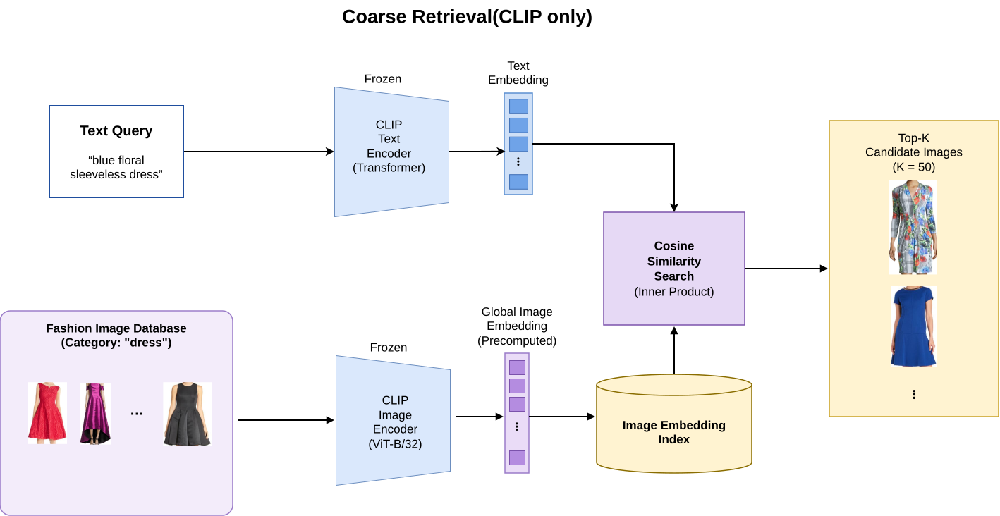

# Fine-Grained Dress Retrieval — CLIP + Cross-Attention Reranking

Text-to-image retrieval on fashion dresses using **OpenAI CLIP (`ViT-B/32`)** with a custom **Cross-Attention Reranker**. CLIP alone struggles with fine-grained attributes (sleeve length, lace texture, neckline cuts) since it compresses an image into a single 512-d vector. This project adds a second stage that uses token-level attention to pick up those details.

---

## System Architecture

### Stage 1 — Coarse Retrieval (CLIP)



The full image gallery is pre-encoded into 512-d CLIP vectors. For any text query, dot-product similarity retrieves the **Top-M candidates** (M = 50) in milliseconds.

### Stage 2 — Cross-Attention Reranking


For each Top-M candidate, text tokens `[77 × 512]` attend over image patch tokens `[50 × 512]` via Multi-Head Cross-Attention. The output is mean-pooled and passed through an MLP to produce a fine-grained relevance score. Final score blends both:

$$\text{Final Score} = \alpha \cdot s_{\text{rerank}} + (1 - \alpha) \cdot s_{\text{clip}} \quad (\alpha = 0.8)$$

---

## Results

Evaluated on **1,197 dress queries** against a 1,197-image test gallery ($M = 50$, optimal blend weight $\alpha = 0.8$, $\tau = 0.1$).

| Metric          | Baseline CLIP | Cross-Attention Reranker |      Δ      |
| :-------------- | :-----------: | :----------------------: | :---------: |
| **Recall@1**    |    11.70%     |        **20.22%**        | **+8.52%**  |
| **Recall@5**    |    29.82%     |        **46.62%**        | **+16.79%** |
| **Recall@10**   |    42.11%     |        **58.81%**        | **+16.71%** |
| **Median Rank** |      15       |          **7**           |   **-8**    |
| **Mean Rank**   |     49.5      |         **44.7**         |  **-4.8**   |

### Alpha Blending Ablation ($M = 50$)

|        $\alpha$        |  Recall@1  |  Recall@5  | Recall@10  | Median Rank |
| :--------------------: | :--------: | :--------: | :--------: | :---------: |
|  0.0 (CLIP baseline)   |   11.70%   |   29.82%   |   42.11%   |     15      |
|          0.7           |   19.47%   |   43.94%   |   56.56%   |      7      |
| **0.8 (Best overall)** | **20.22%** | **46.62%** | **58.81%** |    **7**    |
|          0.9           |   19.72%   |   47.62%   |   59.23%   |      7      |
|  1.0 (Reranker only)   |   18.05%   |   45.36%   |   59.40%   |      7      |

> **Key Finding:** $\alpha = 0.8$ yields the highest top-1 precision (**20.22%**, nearly doubling CLIP's baseline of 11.70%) while cutting the median rank in half (from 15 to 7). Pure reranking ($\alpha = 1.0$) slightly degrades R@1, confirming that a small residual coarse CLIP prior ($1-\alpha = 0.2$) prevents overfitting.

---

## Dataset

Built from **[Fashion200k](https://github.com/xthan/fashion-200k)**, filtered to dresses only, deduplicated to one view per product:

| Split | Size   | File                   |
| :---- | :----- | :--------------------- |
| Train | 12,000 | `data/dress_train.csv` |
| Val   | 1,500  | `data/dress_val.csv`   |
| Test  | 1,197  | `data/dress_test.csv`  |

Download from Hugging Face:

```bash
python scripts/download_dataset.py
```

---

## Setup & Usage

```bash
python3 -m venv venv
source venv/bin/activate
pip install -r requirements.txt
```

**Evaluate** (runs baseline CLIP + reranker benchmark):

```bash
python evaluate.py
python evaluate.py --pool_size 50 --alpha 0.5  # custom settings
```

**Train** the Cross-Attention Reranker (InfoNCE loss):

```bash
python train.py --epochs 3 --batch_size 16 --n_train_samples 2000  # quick run
python train.py --epochs 5 --batch_size 16 --eval_after_training    # full run
```

**Precompute** patch embeddings (speeds up training):

```bash
python scripts/precompute_embeddings.py --data_dir data
```

**Notebooks:**

- [`notebooks/experiment.ipynb`](notebooks/experiment.ipynb) — Baseline CLIP evaluation + query visualizer
- [`notebooks/cross_attention_reranker_experiment.ipynb`](notebooks/cross_attention_reranker_experiment.ipynb) — Full end-to-end experiment with ablations

---

## Key Takeaways

1. **CLIP misses fine-grained details** — it's great at broad concepts but collapses the whole image into one vector, losing spatial info like sleeve length or collar style.
2. **Reranker only sees Top-50** — if the correct dress isn't in CLIP's Top-50, the reranker never sees it. Stage 1 quality sets the ceiling.
3. **Score blending matters** — using only the reranker score risks underfitting on a small training set. Blending with CLIP's score keeps results stable.

---

## References

1. Radford et al., _CLIP_, ICML 2021. [arXiv:2103.00020](https://arxiv.org/abs/2103.00020)
2. Han et al., _Fashion200k_, ICCV 2017.
3. Wu et al., _Fashion IQ_, CVPR 2021. [arXiv:1905.12794](https://arxiv.org/abs/1905.12794)
4. _Candidate Set Re-ranking for Composed Image Retrieval_. [Papers With Code](https://paperswithcode.com/paper/candidate-set-re-ranking-for-composed-image)
